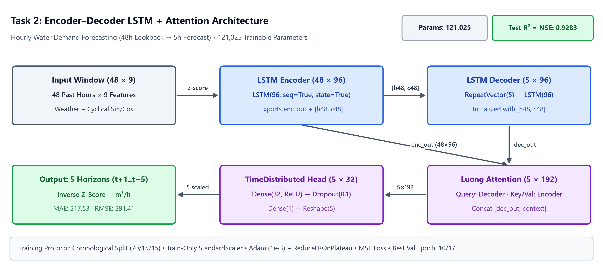
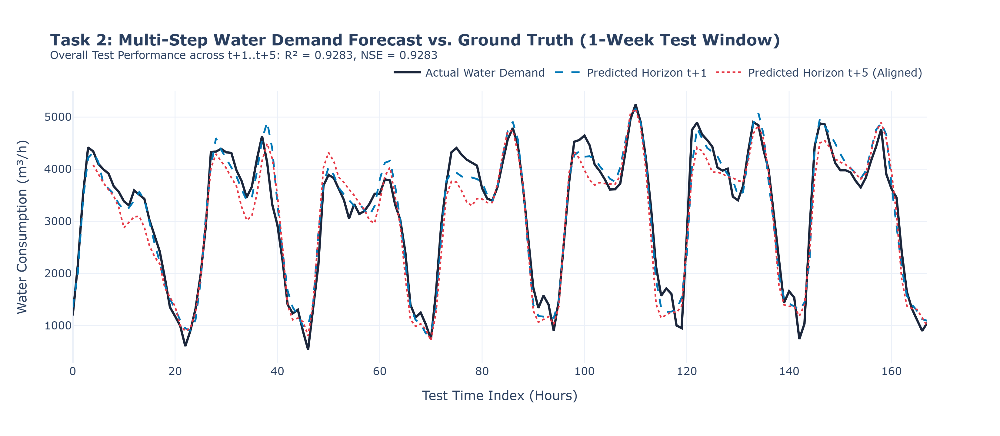
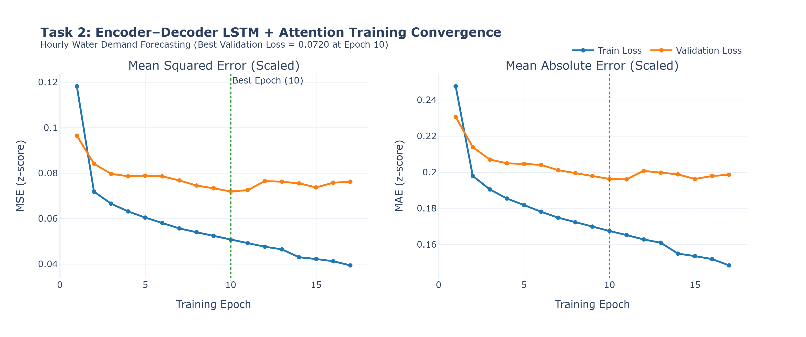
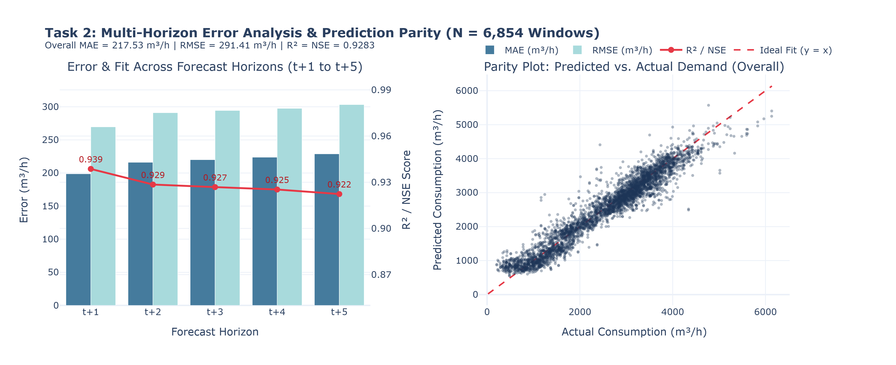
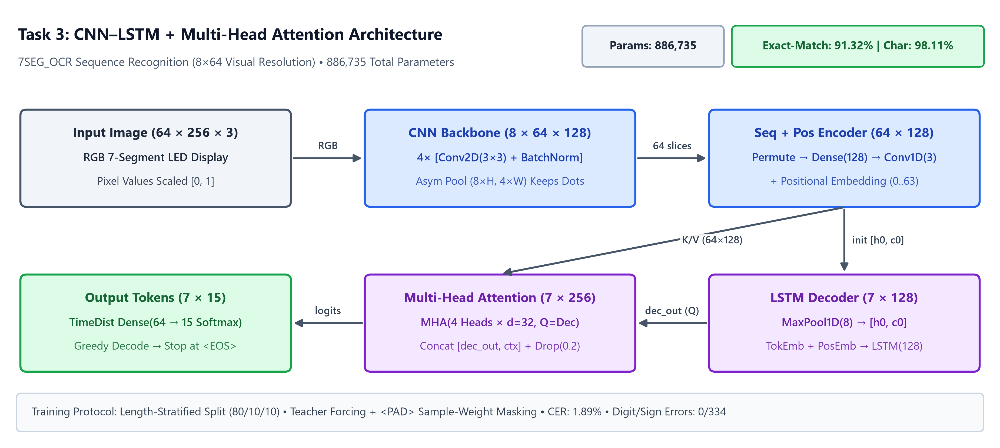
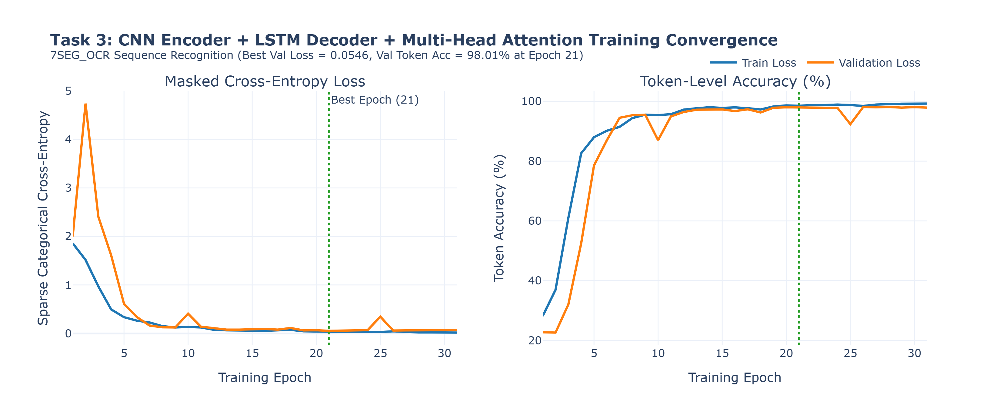
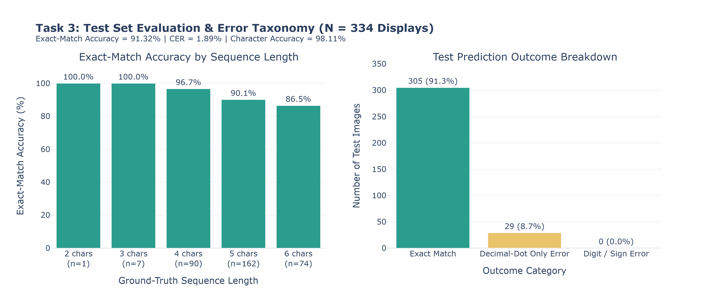
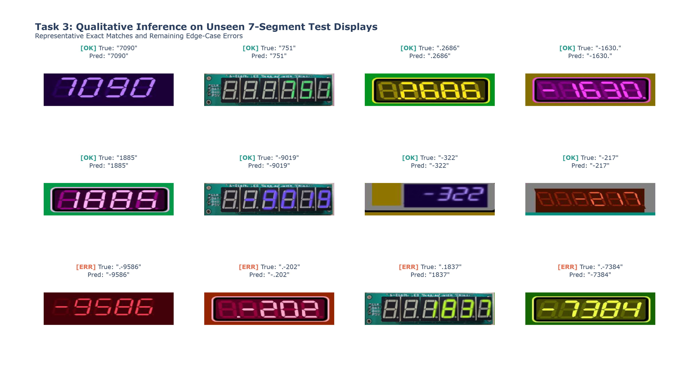

<div align="center">

# Attention-Based Multi-Step Water Demand Forecasting & Seven-Segment Display Recognition

[](https://www.python.org/)
[](https://www.tensorflow.org/)
[](https://keras.io/)
[](figures/)
[-blue?style=flat-square)](#executive-summary--empirical-results)

A clean, self-contained deep learning project completing **Task 2 (Multi-Step Sequence-to-Sequence Time Series Forecasting)** and **Task 3 (Image-to-Sequence Recognition)** using compact Keras Functional API scripts with strict out-of-sample evaluation and zero data leakage.

</div>

---

## Executive Summary & Empirical Results

Following instructor guidance (omitting Task 1), Group 4 designed and evaluated two end-to-end Attention-equipped Sequence-to-Sequence pipelines on distinct, medium-scale public benchmarks:

| Project Task | Dataset & Scale | Primary Scripts | Parameters | Evaluation Split | Key Test Performance |
| :--- | :--- | :--- | :---: | :---: | :--- |
| **Task 2: Water Demand Forecasting** | [Hourly Water Demand (Zenodo)](https://zenodo.org/records/11045013) (`46,032` hourly rows) | [`task2_prepare_data.py`](task2_prepare_data.py)<br>[`task2_seq2seq_attention.py`](task2_seq2seq_attention.py) | `121,025` | Chronological `70/15/15`<br>(`32,170 / 6,852 / 6,854`) | **$R^2 = \text{NSE} = 0.9283$**<br>`MAE = 217.53` \| `RMSE = 291.41 m³/h` |
| **Task 3: 7-Segment Display OCR** | [7SEG_OCR (Hugging Face)](https://huggingface.co/datasets/MiXaiLL76/7SEG_OCR) (`3,333` RGB images) | [`task3_prepare_data.py`](task3_prepare_data.py)<br>[`task3_cnn_lstm_attention.py`](task3_cnn_lstm_attention.py) | `886,735` | Length-Stratified `80/10/10`<br>(`2,666 / 333 / 334`) | **Exact-Match = `91.32%`** (`305/334`)<br>**Char Acc = `98.11%`** \| `CER = 1.89%` |

---

## Theoretical Background & Evaluation Metrics

1. **LSTM Encoder–Decoder (Seq2Seq):** Standard SimpleRNNs suffer from vanishing gradients over long lookbacks (`48` hours). LSTM gates ($f\_t, i\_t, o\_t$) regulate an explicit cell state $c\_t$ to retain multi-day diurnal periodicity, while the Encoder–Decoder bridges variable input windows (`48 × 9`) and multi-step target horizons (`5` hours) or spatial visual slices (`64 × 128`) and variable-length character tokens (`2–6` chars).
2. **Attention Mechanisms:**
   - **Luong Dot-Product Attention (Task 2):** Each future horizon $t+1 \dots t+5$ dynamically weights all `48` encoder hidden states ($\alpha\_{t,s} = \text{softmax}(\mathbf{q}\_t^\top \mathbf{k}\_s)$), preventing context bottlenecks over long horizons.
   - **Multi-Head Cross-Attention with Positional Embeddings (Task 3):** Four parallel attention heads ($\text{head}\_i = \text{Attention}(\mathbf{Q}\mathbf{W}\_i^Q, \mathbf{K}\mathbf{W}\_i^K, \mathbf{V}\mathbf{W}\_i^V)$) track spatial left-to-right alignment, digit strokes, and tiny decimal points simultaneously.
3. **Evaluation Formulations:**
   - **Task 2 (Overall & Per-Horizon):**

     $$
     \text{MAE} = \frac{1}{M}\sum |y\_k - \hat{y}\_k|, \quad \text{RMSE} = \sqrt{\frac{1}{M}\sum (y\_k - \hat{y}\_k)^2}, \quad R^2 = \text{NSE} = 1 - \frac{\sum (y\_k - \hat{y}\_k)^2}{\sum (y\_k - \bar{y})^2}
     $$

     *(Note: When $R^2$ is computed as the coefficient of determination $1 - \text{SS}\_{\text{res}}/\text{SS}\_{\text{tot}}$, it is mathematically identical to hydrological Nash–Sutcliffe Efficiency $\text{NSE}$, where $\text{NSE} > 0.90$ indicates excellent predictive skill.)*
   - **Task 3 (Sequence OCR):**

     $$
     \text{Exact-Match} = \frac{1}{N}\sum\_{i=1}^N \mathbb{I}(\hat{S}\_i = S\_i), \quad \text{CER} = \frac{\sum\_{i=1}^N \text{Levenshtein}(\hat{S}\_i, S\_i)}{\sum\_{i=1}^N |S\_i|}, \quad \text{Char Acc} = 1 - \text{CER}
     $$

---

## Task 2: Encoder–Decoder LSTM with Attention (Water Demand)

- **Scripts:** [`task2_prepare_data.py`](task2_prepare_data.py) · [`task2_seq2seq_attention.py`](task2_seq2seq_attention.py)
- **Dataset:** *Hourly Water Demand of a Mixed District Recorded by Supplier* (`46,032` hourly observations from Jan 1, 2016 to Apr 1, 2021; `Consumption` ranges `1–6,514 m³/h`, mean `2,314.34 m³/h`, std `1,032.14 m³/h`, alongside `Temperature`, `Rain` with 25 missing rows filled to `0.0`, and `Sun`).



### Modeling & Analytical Findings
1. **Cyclical Time Encoding & Windowing:** Timestamps are mapped onto unit circles (`hour_sin/cos`, `dow_sin/cos`) plus `IsWeekend`, avoiding artificial midnight (`23 → 0`) discontinuities across a `48`-hour encoder window (`2` diurnal cycles).
2. **Graceful Horizon Stability:** Across **6,854 unseen Test windows**, error grows smoothly by only `+15.1%` in MAE from $t+1$ (`198.74 m³/h`) to $t+5$ (`228.86 m³/h`), maintaining **$\text{NSE} \ge 0.9223$** across all five future hours.
3. **Practical Utility:** An overall error near `~217 m³/h` (`~9.4%` of mean district load) over a 5-hour lookahead supports proactive pump scheduling during off-peak electricity tariffs and reservoir buffer management.

| Forecast Horizon | $R^2$ | NSE | MAE ($\text{m}^3/\text{h}$) | RMSE ($\text{m}^3/\text{h}$) |
| :--- | :---: | :---: | :---: | :---: |
| **Overall ($t+1 \dots t+5$)** | **0.9283** | **0.9283** | **217.53** | **291.41** |
| Horizon $t+1$ | 0.9387 | 0.9387 | 198.74 | 269.62 |
| Horizon $t+2$ | 0.9285 | 0.9285 | 216.16 | 291.04 |
| Horizon $t+3$ | 0.9268 | 0.9268 | 220.07 | 294.43 |
| Horizon $t+4$ | 0.9253 | 0.9253 | 223.82 | 297.55 |
| Horizon $t+5$ | 0.9223 | 0.9223 | 228.86 | 303.29 |



| Training Convergence | Horizon Error Breakdown & Parity Plot |
| :---: | :---: |
|  |  |

---

## Task 3: Spatial-Aware CNN–LSTM with Multi-Head Attention (7SEG_OCR)

- **Scripts:** [`task3_prepare_data.py`](task3_prepare_data.py) · [`task3_cnn_lstm_attention.py`](task3_cnn_lstm_attention.py)
- **Dataset:** *7SEG_OCR* (`3,333` RGB seven-segment display images resized to `64 × 256 × 3`, sequences of `2–6` characters over `-.0123456789`, `15` vocabulary tokens including `<PAD>`, `<SOS>`, `<EOS>`).



### Iterative Optimization & Architectural Gains
Recognizing multi-color LED displays requires preserving tiny 2–3 pixel decimal points (`.`) while enforcing strict left-to-right digit order:

| Iteration | Key Design Refinement | Exact-Match Seq Acc | CER | Char Accuracy |
| :--- | :--- | :---: | :---: | :---: |
| Baseline v1 | `70/15/15`, `W=32` width steps, `Attention()` without position encoding | `60.00%` | `14.01%` | `85.99%` |
| Iteration v2 | Added learned Positional Embeddings + 4-head `MultiHeadAttention` | `86.40%` | `3.25%` | `96.75%` |
| Iteration v3 | Length-stratified `80/10/10` split + `64` horizontal steps + `GaussianNoise` | `88.32%` | `2.69%` | `97.31%` |
| **Final Model** | **Removed noise, preserved `8×64` spatial grid, added `Conv1D` + `MaxPooling1D(8)` state init** | **`91.32%`** *(305/334)* | **`1.89%`** | **`98.11%`** |

### Error Diagnostics & Qualitative Inference ($N = 334$ Test Displays)
- **Zero Digit or Sign Errors (`0 / 334`):** Every numeric digit (`0–9`) and minus sign (`-`) across all 334 unseen test images was recognized with **100.00% accuracy** (`100%` exact match on length 2–3, `96.7%` on length 4, `90.1%` on length 5, `86.5%` on length 6).
- **Remaining Edge Case (`29 / 29`):** All 29 mismatches (`8.68%`) are exclusively faint synthetic decimal dots (`.`) appearing on unlit background segments.
- **Masked Teacher Forcing & Autoregressive Decoding:** During training, `sample_weight` masks out `<PAD>` tokens so variable-length padding never inflates loss or accuracy; at inference, `greedy_decode()` predicts one character at a time from `<SOS>` until `<EOS>`.

| Training Convergence | Accuracy by Length & Error Taxonomy |
| :---: | :---: |
|  |  |



---

## Data Engineering & Leakage Prevention

1. **Zero-Leakage Time Series Partitioning (Task 2):** Split strictly chronologically (`70%` Train / `15%` Val / `15%` Test) without shuffling. `StandardScaler` computes $\mu$ and $\sigma$ **only on the Training slice** before transforming Validation and Test slices.
2. **Length-Stratified Image Splitting (Task 3):** Two-stage stratified split (`random_state=42`, `stratify=seq_len`) guarantees balanced `2–6` character sequence distributions across `Train (2,666)`, `Val (333)`, and `Test (334)`.
3. **Deterministic Reproducibility:** `SEED = 42` is fixed across `PYTHONHASHSEED`, Python `random`, `numpy`, and `tensorflow`.

---

## Environment Setup & End-to-End Execution

> **Note on Data & Git:** Raw and processed data folders (`data/raw/` = `~390.5 MB` including `7seg_train.parquet` at `192.5 MB`, exceeding GitHub's `100 MB` file limit; `data/processed/` = `~88.5 MB`) are excluded via [`.gitignore`](.gitignore). Running the preparation scripts below automatically downloads and reconstructs everything locally.

### 1. Installation
Create a Python 3.11+ virtual environment and install dependencies from [`requirements.txt`](requirements.txt):

```bash
python -m venv .venv
# Windows PowerShell:
.venv\Scripts\Activate.ps1
# Linux / macOS:
# source .venv/bin/activate

pip install -r requirements.txt
```

### 2. Flat Pipeline Execution
All scripts use simple relative paths (`./data/raw/...`, `./data/processed/...`, `./figures/...`) and run directly from the project root:

<details open>
<summary><b>Click to view step-by-step execution commands</b></summary>

```bash
# Task 2: Download Zenodo CSV, engineer features, split & save task2_data.npz
python task2_prepare_data.py

# Task 2: Train LSTM Seq2Seq + Attention & evaluate R², NSE, MAE, RMSE
python task2_seq2seq_attention.py

# Task 3: Download Hugging Face 7SEG_OCR parquet, extract PNGs & split 80/10/10
python task3_prepare_data.py

# Task 3: Train CNN-LSTM + Multi-Head Attention & evaluate Exact-Match / CER
python task3_cnn_lstm_attention.py

# Generate all high-resolution PNG (300 DPI / scale=3) & SVG figures in ./figures/
python generate_figures.py
```

</details>

---

## Repository Map

```text
├── data/                         # Excluded from Git (.gitignore); auto-populated by prepare scripts
│   ├── raw/                      # water_demand.csv, 7seg_train.parquet, 7seg_images/, 7seg_labels.csv
│   └── processed/                # task2_data.npz, *.keras models, task2_eval.npz, task3_eval.npz
├── figures/                      # High-resolution .png & vector .svg charts and architecture diagrams
├── task2_prepare_data.py         # Task 2 Step 1: Zenodo download, cyclical features, 70/15/15 split
├── task2_seq2seq_attention.py    # Task 2 Step 2: LSTM Encoder-Decoder + Attention training & evaluation
├── task3_prepare_data.py         # Task 3 Step 1: Hugging Face 7SEG_OCR PNG extraction & 80/10/10 split
├── task3_cnn_lstm_attention.py   # Task 3 Step 2: CNN + Conv1D + LSTM + MHA training & greedy decode
├── generate_figures.py           # Standalone Plotly & Matplotlib high-resolution figure generator
├── requirements.txt              # Tested Python dependencies (TensorFlow 2.21, Scikit-Learn, Plotly)
├── .gitignore                    # Excludes .venv/, __pycache__/, data/raw/, and data/processed/
└── README.md                     # Project overview, theory, architecture specs, results & usage guide
```
